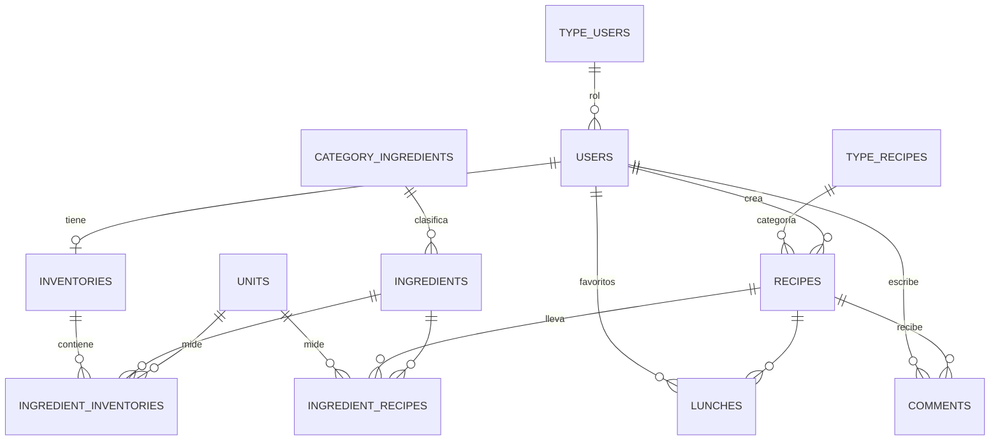

# LoncheS 🍽️

Aplicación web para **descubrir, crear y gestionar recetas de cocina a partir de los ingredientes que tienes en casa**. Los usuarios llevan un inventario de su despensa, buscan recetas según los ingredientes disponibles y ven qué porcentaje de cada receta pueden preparar con lo que ya tienen.

Desarrollada con **Laravel 11 (PHP 8.2)** bajo el patrón **MVC**, con base de datos **MySQL**, vistas **Blade** y **Bootstrap 5**.

---

## Funcionalidades

### Usuarios
- **Registro con verificación por correo:** al registrarse, el usuario recibe un código de 6 dígitos para activar su cuenta.
- **Inicio de sesión y recuperación de contraseña** por correo electrónico.
- **Validación de formularios** en el cliente (JavaScript) y en el servidor (validaciones de Laravel).
- **Catálogo de recetas** filtrable por categoría, con detalle de ingredientes, cantidades y pasos de preparación.
- **Búsqueda por ingredientes:** el usuario selecciona lo que tiene y la app le muestra las recetas que puede preparar.
- **Inventario personal** (despensa): agregar, editar y eliminar ingredientes con su cantidad y unidad de medida.
- **Porcentaje de disponibilidad:** en cada receta, el usuario suscriptor ve qué porcentaje de los ingredientes ya tiene en su inventario.
- **Favoritos y comentarios** en las recetas.
- **Perfil de usuario** editable, con foto.

### Administrador
- **Panel de control (dashboard)** con gráficas estadísticas en **Chart.js**: usuarios por tipo, registros en el tiempo y recetas por categoría. Los datos se obtienen de endpoints que responden en **JSON** y se consumen con `fetch`.
- **CRUD completo** de recetas, ingredientes (incluye información nutricional) y usuarios.
- Carga de imágenes para recetas, ingredientes y usuarios.

### Seguridad y control de acceso
- Rutas protegidas con el middleware `auth` de Laravel.
- Middleware propio **`CheckAdmin`** que restringe el panel administrativo a usuarios con rol de administrador.
- Middleware propio **`NoCacheMiddleware`** que evita que el navegador muestre páginas privadas desde caché después de cerrar sesión.
- Roles de usuario: **Administrador**, **Normal** y **Suscriptor**.

---

## Tecnologías

| Capa | Tecnología |
|---|---|
| Backend | PHP 8.2, Laravel 11, Eloquent ORM |
| Base de datos | MySQL |
| Frontend | Blade, Bootstrap 5, JavaScript, Chart.js |
| Correo | Laravel Mail (código de verificación y restablecimiento de contraseña) |
| Herramientas | Composer, npm, Vite, Git |

---

## Arquitectura

El proyecto sigue la estructura estándar de Laravel con el patrón **Modelo–Vista–Controlador**:

```
app/
├── Http/
│   ├── Controllers/      # 12 controladores (recetas, ingredientes, inventario, usuarios, comentarios…)
│   │   └── Auth/         # Registro, login, verificación de correo y recuperación de contraseña
│   └── Middleware/       # CheckAdmin, NoCacheMiddleware
└── Models/               # 11 modelos Eloquent
database/
├── migrations/           # Definición de las tablas y sus relaciones
└── seeders/              # Datos iniciales (roles, unidades, categorías, ingredientes, recetas, admin)
resources/views/          # Vistas Blade: auth, admin, crud, recetas, usuario, modales, correos
routes/web.php            # Rutas públicas, de usuario y de administrador
public/assets/documents/  # Documentación del proyecto (PDF)
```

### Modelo de datos



Las relaciones muchos a muchos (recetas–ingredientes, inventario–ingredientes, usuarios–recetas favoritas) se manejan con tablas intermedias y `belongsToMany` de Eloquent.

---

## Instalación local

### Requisitos
- PHP 8.2 o superior
- Composer
- MySQL
- Node.js y npm

### Pasos

```bash
# 1. Clonar el repositorio
git clone https://github.com/Maorez18/LoncheS.git
cd LoncheS

# 2. Instalar dependencias
composer install
npm install

# 3. Configurar el entorno
cp .env.example .env
php artisan key:generate
```

Edita el archivo `.env` con los datos de tu base de datos (por defecto usa una base llamada `lonches`):

```env
DB_CONNECTION=mysql
DB_HOST=127.0.0.1
DB_PORT=3306
DB_DATABASE=lonches
DB_USERNAME=root
DB_PASSWORD=
```

```bash
# 4. Crear las tablas
php artisan migrate

# 5. Cargar los datos iniciales (en este orden)
php artisan db:seed --class=TypeUserSeeder
php artisan db:seed --class=AdminSeeder
php artisan db:seed --class=UnitSeeder
php artisan db:seed --class=CategoryIngredientSeeder
php artisan db:seed --class=IngredientsSeeder
php artisan db:seed --class=TypeRecipeSeeder
php artisan db:seed --class=RecipeSeeder
php artisan db:seed --class=IngredientRecipeSeeder

# 6. Compilar recursos y levantar el servidor
npm run dev
php artisan serve
```

La aplicación queda disponible en `http://localhost:8000`.

> **Usuario administrador:** `AdminSeeder` crea una cuenta de administrador inicial. Revisa sus credenciales en `database/seeders/AdminSeeder.php` y cámbialas antes de usar la app fuera de tu entorno local.

> **Correo:** con `MAIL_MAILER=log`, los códigos de verificación y los correos de recuperación se escriben en `storage/logs/laravel.log` en lugar de enviarse. Para enviarlos de verdad, configura un servidor SMTP en `.env`.

> **Carga de imágenes:** las rutas de carga apuntan a `public_html/uploads`, la carpeta del hosting donde se desplegó el proyecto. Para trabajar en local, usa la línea comentada `public_path('uploads/...')` en los controladores.

---

## Documentación

El proyecto incluye documentación formal en [`public/assets/documents`](public/assets/documents):

- [Manual técnico](<public/assets/documents/Manual técnico de LoncheS.pdf>)
- [Manual de usuario](<public/assets/documents/Manual de usuario de LoncheS.pdf>)
- [Diccionario de datos](public/assets/documents/DiccionarioDatos.pdf)
- [Informe del proyecto](public/assets/documents/InformeLoncheS.pdf)
- [Política de seguridad](<public/assets/documents/Política de seguridad.pdf>)

---

## Autor

**Victor Mauricio Pérez Castillo**
Ingeniero de Sistemas · Desarrollador de Software

- LinkedIn: [victor-mauricio-perez-castillo](https://www.linkedin.com/in/victor-mauricio-perez-castillo-3512a22b3)
- Correo: victorperezc18@gmail.com
